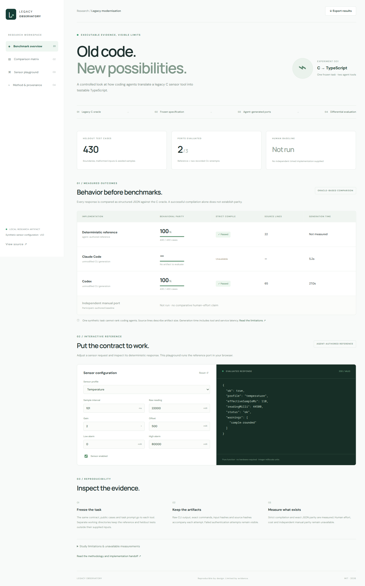

# Legacy Modernisation Agent Benchmark

An executable C sensor oracle, independently implemented TypeScript ports, and an Angular report for inspecting coding-agent modernisation evidence.

[Report data](artifacts/report.json) · [Method](docs/METHODOLOGY.md) · [Architecture handoff](docs/IMPLEMENTATION_HANDOFF.md) · [Frozen task](spec/AGENT_TASK.md)



The project translates a small synthetic sensor configuration tool from C into TypeScript. It preserves the generated source, raw CLI records, input hashes, and oracle observations so readers can inspect each result.

The comparison separates an agent-authored deterministic reference from actual CLI attempts. No independently produced human baseline was supplied. The report leaves human effort and comparable cost unavailable.

## Run locally

Requires Node.js 26, npm, Python 3.11+, and a C compiler with AddressSanitizer and UndefinedBehaviorSanitizer.

```bash
git clone https://github.com/MaheshBhushan/legacy-modernisation-agent-benchmark.git
cd legacy-modernisation-agent-benchmark
npm ci
make verify
npm run benchmark
npm start
```

Open `http://localhost:4200`. The Angular dashboard shows measured parity, compiler results, and a sensor configuration playground. The playground uses the deterministic reference and runs entirely in the browser. The export button downloads the full report.

## Recorded results

| Implementation | Exact JSON parity | Strict compile | Evidence |
|---|---:|---|---|
| Agent-authored reference | 430 / 430 | Passed | [Source](ports/reference/src/port.ts) |
| Codex, GPT-6.1 Sol medium | 430 / 430 | Passed | [Original artifact](variants/codex/port.ts), [provenance](variants/codex/provenance.json) |
| Claude Code, Sonnet | Unavailable | No artifact | [Provider usage-limit response](variants/claude-code/stdout.jsonl) |
| Independent manual baseline | Not run | Not run | [Import workflow](docs/METHODOLOGY.md#independent-manual-baseline) |

These results cover 430 deterministic heldout requests across malformed requests, boundary conditions, 300 seeded random requests, and both sensor profiles. Nine public examples were supplied during generation. Evaluation corpus v2 removes five overlaps and adds three integral JSON-number cases; no generation feedback was supplied. Both profiles appeared in the task specification. These results measure cross-profile parity and do not establish transfer to unseen tasks.

Claude's first attempt failed authentication in bare mode. Its authenticated retry reached an API usage limit. The provider reported access would resume on 2026-11-01. The repository retains both attempts and does not substitute a generated port.

Run `python -m benchmark.mutation` to evaluate suite sensitivity against five injected reference faults. See [methodology](docs/METHODOLOGY.md) for study limits and specification-recovery provenance.

## Structure

- `legacy/` — strict C oracle with bounded integer arithmetic.
- `benchmark/` — Python standard-library orchestration, isolated generation and differential evaluation.
- `spec/` — frozen contract, public examples and generator task.
- `ports/reference/`, `variants/` — reference and unmodified CLI artifacts.
- `artifacts/` — measured reports and actual oracle probes.
- `web/` — Angular observatory and configuration playground.

## Verify and reproduce

```bash
make verify                      # C build, Python tests, sanitizers, TypeScript check, Angular build
npm run benchmark                # regenerate report from recorded artifacts; no agent credentials
python -m benchmark.mutation     # inject five faults and evaluate suite sensitivity
```

CI repeats these checks on pushes and pull requests. Generation retries require authenticated Claude Code and Codex CLIs. Preserve existing attempts before running `python -m benchmark.experiment`. **Security note:** the recorded Claude Code attempt uses `--permission-mode bypassPermissions`, under which `--allowedTools Read,Write,Edit` does not restrict tools; the agent can run shell commands and reach the network with your environment. The flags are kept unchanged so reruns match the published method. Run generation retries only inside a disposable VM or container that holds no credentials other than the agent CLI login. Published heldout cases can contaminate new attempts.

## License and credits

MIT. Built for Mahesh Bhushan. GPT-6.1 Sol implemented the project from a GPT-6 Astra architecture handoff. The deterministic reference is agent-authored. Individual generated artifacts retain their tool and model provenance.
